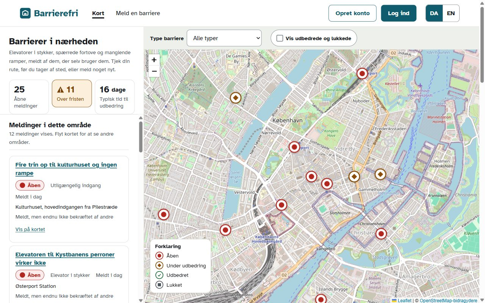
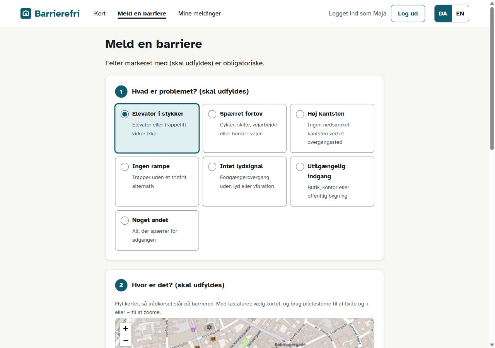
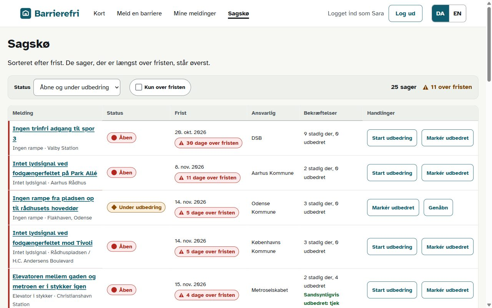

# Barrierefri

A broken lift at a metro station can cut a wheelchair user off from the whole
network, and they usually find out when they're standing in front of it. The same
goes for a kerb without a dropped section, a crossing without an audio signal, or e-scooters
dumped across the tactile paving.

Barrierefri lets anyone report these barriers on a map. Other people confirm
whether they're still there, and the municipality or transport operator gets a
case queue sorted by how overdue each repair is. Anyone can check their route
before they leave home, without an account.

The app is meant to be used by the people it's about, so accessibility isn't an
afterthought: it's tested against WCAG 2.2 AA in the test suite and in the browser.



| Reporting a barrier | Case queue for staff |
|---|---|
|  |  |

## Features

- **Public map and list** of reported barriers. The map fills the screen, with the
  list beside it on desktop and below it on phones. Each status has its own marker
  shape, not just its own colour, and a legend explains them.
- **Reporting** in three steps (what, where, details) with a crosshair location
  picker that works with a keyboard, "use my location", and an optional photo.
- **Duplicate detection.** While you fill in the form, existing reports of the same
  kind within 30 metres are suggested, and the server double-checks on submit.
- **Report pages** lead with the status and the deadline ("Frist 18. jan.", or an
  "Over fristen" badge with the number of days when it's late), next to a small map
  and the photo.
- **Crowd confirmation.** People mark a barrier as "still there" or "fixed" with
  two large buttons that show the counts. The confidence score and a "probably
  fixed" flag tell staff where to look first.
- **Case queue** for staff, with SLA deadlines per category (2 days for a broken
  lift, 90 for a missing ramp). Overdue cases come first with a days-over badge,
  and common status changes can be made straight from the queue. Public notes and
  full history are on each report. On phones the queue becomes a list of cards.
- **Public statistics** on the map page: open reports, overdue reports, typical
  time to fix.
- **Power BI report** on dedicated SQL views ([guide](docs/power-bi.md)).

## Where the information comes from

Each report page ends with a "Hvor kommer oplysningerne fra?" ("Where does this
information come from?") section, collapsed by default, so nobody mistakes the
app's own rules for official ones:

| Information | Source |
|---|---|
| Report text and photo | The person who reported it; staff can reject a report with a public reason |
| Deadline for fixing | Barrierefri's own targets (2 days for a lift up to 90 for kerbs and ramps), not a law; marked as such in the app |
| Confirmations and "probably fixed" | Calculated by Barrierefri from people's answers |
| Map | OpenStreetMap and its contributors |

The demo reports are written in Danish, as Danish users would write them. They are
user content, so they don't change with the language switch.

## Languages

The interface is in **Danish by default**, with **English** available from the
DA / EN switcher in the top-right corner of every page, at every screen width (on
phones it sits next to the menu button rather than inside it). The choice is remembered
in the browser, and a first visit always starts in Danish, whatever the browser's
own language is.

- Texts live in `frontend/src/i18n/da.json` and `en.json` and are loaded with
  [react-i18next](https://react.i18next.com). A test checks that both files have
  exactly the same keys and placeholders.
- Dates and numbers follow the chosen language through `Intl`: `1. dec. 2026`,
  `16,5` and "for 3 dage siden" in Danish; `1 Dec 2026`, `16.5` and "3 days ago" in
  English. Times are always Danish time.
- `<html lang>` and the page title change with the language, and the Keycloak login
  page opens in the same language.
- The switcher is a `fieldset` with a hidden legend and two 44 px buttons using
  `aria-pressed`. Each button's accessible name starts with its visible text
  ("DA – Dansk") so voice control works, and carries its own `lang` attribute.
  It is covered by axe-core and keyboard tests in both languages.
- The API and the database stay in English. Errors carry a stable `code` (for
  example `STATUS_TRANSITION_INVALID`, with the statuses as `params`) that the app
  turns into its own sentence; form errors are mapped by field, never shown as the
  server's English text.

## Tech stack

| Area | Technology |
|---|---|
| Backend | C# 14, .NET 10, ASP.NET Core Web API (controllers), Entity Framework Core 10 with Npgsql, FluentValidation, health checks, OpenAPI + Scalar |
| Security | JWT bearer authentication with Keycloak (OIDC, PKCE), role-based policies |
| Storage | PostgreSQL 16; Azure Blob Storage for photos (Azurite locally, run with `--skipApiVersionCheck` because the Azure SDK can be newer than the Azurite image) |
| Frontend | React 19, TypeScript, Vite, React Router, TanStack Query, react-i18next, Leaflet + OpenStreetMap |
| Testing | xUnit, WebApplicationFactory, Testcontainers (PostgreSQL + Azurite), Coverlet; Vitest, Testing Library, axe-core |
| Tooling | oxlint with jsx-a11y rules, Prettier, Docker Compose, Azure DevOps Pipelines |
| Reporting | Power BI |

## Getting started

You need [Docker Desktop](https://www.docker.com/products/docker-desktop/).

```bash
git clone https://github.com/HamsaALT/barrierefri.git
cd barrierefri
docker compose up --build
```

The first build takes a few minutes. When `docker compose ps` shows every service
except Azurite as `healthy`, open **http://localhost:3000**.

Demo users (password `demo` for all):

| User | Role | What to try |
|---|---|---|
| `maja` | Citizen | Report a barrier, confirm other people's reports |
| `lars` | Citizen | Same as Maja, with his own reports under "My reports" |
| `sara` | Staff | Case queue, change status, assign to DSB or a municipality |
| `admin` | Admin | Everything staff can do |

| Service | URL |
|---|---|
| Web app | http://localhost:3000 |
| API reference (Scalar) | http://localhost:5080/docs |
| OpenAPI document | http://localhost:5080/openapi/v1.json |
| Health check | http://localhost:5080/health |
| Keycloak admin | http://localhost:8082 (admin / admin) |
| PostgreSQL | localhost:5434, database `barrierefri` |

The database is migrated automatically on startup, demo data included. Stop with
`docker compose down`, and add `-v` to start over with a fresh database.

## Development

Run the infrastructure in Docker and the API and frontend locally:

```bash
docker compose up -d postgres azurite keycloak
```

API ([.NET 10 SDK](https://dotnet.microsoft.com/download)):

```bash
cd backend
dotnet run --project src/Barrierefri.Api      # http://localhost:5080
```

Frontend (Node 24):

```bash
cd frontend
npm ci
npm run dev                                   # http://localhost:5173, proxies /api to :5080
```

### Tests

```bash
cd backend
dotnet test --settings coverlet.runsettings
```

`Barrierefri.UnitTests` covers the domain rules (status workflow, votes, confidence,
SLA, geo maths, file sniffing, validators). `Barrierefri.IntegrationTests` starts the
real API against PostgreSQL 16 and Azurite in Docker using Testcontainers, so Docker
must be running. It checks things like duplicate detection in SQL, photo upload to
blob storage, authorisation rules and the Power BI role's permissions.

```bash
cd frontend
npm run test:ci        # Vitest + Testing Library + axe-core
npm run lint           # oxlint, including jsx-a11y rules
npm run format:check
```

### Database migrations

Migrations live in `backend/src/Barrierefri.Api/Data/Migrations`. To add one:

```bash
cd backend
dotnet tool restore
dotnet ef migrations add <Name> --project src/Barrierefri.Api --output-dir Data/Migrations
```

| Migration | Contents |
|---|---|
| `InitialSchema` | Tables, indexes and check constraints, generated from the EF model |
| `DemoData` | Demo reports at real places, votes, history, and a year of resolved cases |
| `ReportViews` | Power BI views and the read-only `powerbi_reader` role |
| `DanishDemoData` | Danish titles, places and staff notes for the demo reports |

## Accessibility

The goal is WCAG 2.2 level AA. How that's checked:

- **Automated, in CI:** every page component test runs axe-core and fails on any
  violation. Colour contrast can't be measured in jsdom, so a separate test reads the
  colour tokens from `styles.css` and checks every text/background pair against 4.5:1
  and every border/focus colour against 3:1. oxlint runs the jsx-a11y rule set.
- **In the browser:** axe-core in Chrome on the map page and case queue (with
  contrast checks) reports no violations.
- **By design:**
  - A skip link, and visible 3 px focus outlines everywhere.
  - Focus moves to the page heading after navigation, so screen readers announce the
    new page.
  - Form errors are collected in a summary that gets focus and links to each field.
    Fields are marked `aria-invalid` and point at their message.
  - The map is never the only way to do something. Every report on the map is also
    in the list next to it, and locations are picked by moving the map under a fixed
    crosshair, which works with arrow keys.
  - Status is shown with text and shape, not colour alone.
  - Targets are at least 44 × 44 px. The font is Atkinson Hyperlegible, designed for
    low-vision readers, and motion is reduced when the OS asks for it.
  - On narrow screens the navigation folds into a menu button that reports its
    state (`aria-expanded`), closes with Escape and returns focus to the button.
  - Pages never sit blank while loading: a static shell shows before the app
    starts, and grey placeholders show while data loads.

Automated tools find roughly a third of accessibility problems. Testing with a screen
reader (NVDA, VoiceOver) and with people who rely on one is the next step.

## How it works

```
Browser (React) ──► nginx ──► ASP.NET Core API ──► PostgreSQL
      │                             │
      └─ login (OIDC + PKCE) ─► Keycloak    └──► Blob Storage (photos)
```

- **Duplicate detection.** A bounding box query uses the latitude/longitude index to
  narrow things down, then the haversine formula in SQL keeps reports within 30 m.
- **Confidence.** `(still there + 2) / (still there + fixed + 3)`. A new report starts
  at 2/3, and no single vote can push it to 0 or 1. The reporter can't confirm their
  own report, because it's already counted.
- **Status workflow.** Open → Being fixed → Fixed, or Closed with a required public
  explanation. Fixed and Closed can be reopened, which resets the deadline and votes.
  Invalid transitions return 409.
- **Photos** are checked by their first bytes (JPEG, PNG and WebP only, max 5 MB),
  stored in a private blob container, and served through the API.
- **Privacy.** Public endpoints and the Power BI views never expose who reported
  something or who changed it.
- **Errors** follow RFC 9457 problem details everywhere.
- **Start-up.** The app renders straight away as a guest and checks for a Keycloak
  session in the background (`check-sso`, with a 2.5 s limit on the silent check).
  Browsers that block third-party cookies used to wait 10 seconds on a blank page
  before anything showed.

## CI/CD

The pipeline runs on **Azure DevOps** (`azure-pipelines.yml`): backend and frontend
build and test in parallel, test results and coverage are published to the run, and
Docker images are built when everything passes. Setup steps are in
[docs/azure-devops.md](docs/azure-devops.md).

## License

[MIT](LICENSE)

## Author

**Hamsa Hassan** – [LinkedIn](https://www.linkedin.com/in/hamsa-hassan-85b3a3378/)
